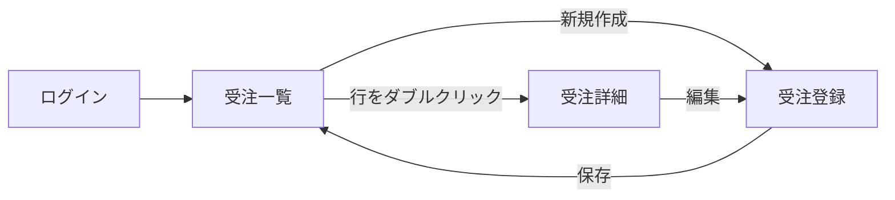
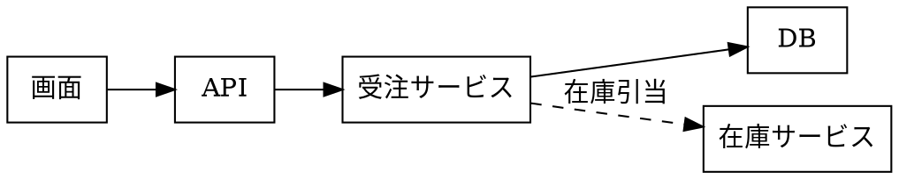
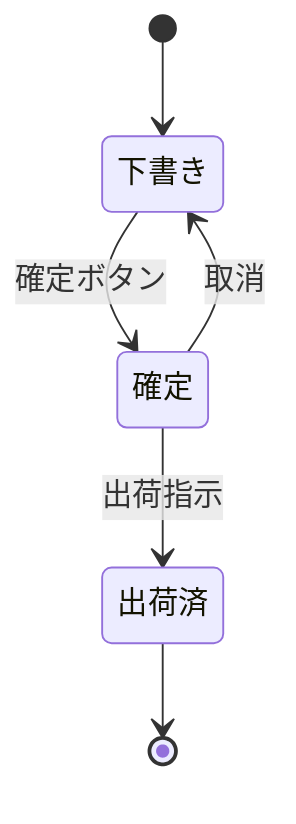

# 図・表フェンス

画面モック (` ```uivolve `) のほかに、仕様書でよく使う**図・チャート・表**も
コードフェンスに **その言語の DSL だけ**を書けば描画される。uivolve の YAML で包む必要はない。
GitHub と同じく、言語名を書いたフェンスは必ず図になる (ソースのまま見せたいときは ` ```text ` などにする)。

| フェンス | 本文 | 向いている用途 |
|---|---|---|
| ` ```mermaid ` | Mermaid 記法 | 画面遷移・処理フロー・シーケンス・状態遷移・ガント |
| ` ```dbml ` | DBML (dbdiagram.io の記法) | テーブル定義と ER 図 |
| ` ```dot ` / ` ```graphviz ` | DOT 言語 | 依存関係・構成図 |
| ` ```math ` | TeX (KaTeX) | 料金・集計などの計算式 |
| ` ```csv ` / ` ```tsv ` | CSV / TSV (1 行目が見出し) | コード値一覧・項目定義 (Excel から貼り付け) |
| ` ```table ` | JSON5 / YAML (行の配列 + 列定義) | 列幅・寄せを指定したい表 |
| ` ```echarts ` | ECharts の option (JSON5 / YAML) | ダッシュボードの KPI・グラフ |
| ` ```vega-lite ` | Vega-Lite の spec (JSON5 / YAML) | 宣言的なグラフ (AI に書かせやすい) |
| ` ```wavedrom ` | WaveJSON (JSON5 / YAML) | タイミングチャート・ビットフィールド |

どのフェンスも meta に `height=<高さ>` と `theme=<neptune|classic|gray|dark>` を書ける
(`height` 省略時は中身なり、チャートは 320px)。
書き間違えたときはブロック内にエラー内容と元のソースが表示され、ほかの図は普通に描画される。

## 画面遷移 (mermaid)

````md

````


## テーブル定義 (dbml)

列の型・PK / FK / UK・NOT NULL・note が ER 図に出る。複数列に `[pk]` を付けると複合主キー。

````md
```dbml
Table customers {
  id int [pk]
  code varchar(10) [unique, not null, note: '顧客コード']
  name varchar(100) [not null]
}

Table orders {
  id int [pk]
  customer_id int [not null, ref: > customers.id]
  ordered_on date [not null]
  status varchar(10) [note: 'draft / confirmed / shipped']
}

Table order_lines {
  order_id int [pk, ref: > orders.id]
  line_no int [pk]
  product_code varchar(20) [not null]
  qty int [not null]
}
```
````

```dbml
Table customers {
  id int [pk]
  code varchar(10) [unique, not null, note: '顧客コード']
  name varchar(100) [not null]
}

Table orders {
  id int [pk]
  customer_id int [not null, ref: > customers.id]
  ordered_on date [not null]
  status varchar(10) [note: 'draft / confirmed / shipped']
}

Table order_lines {
  order_id int [pk, ref: > orders.id]
  line_no int [pk]
  product_code varchar(20) [not null]
  qty int [not null]
}
```

## モジュール構成 (dot)

````md

````


## 計算式 (math)

````md
```math
\text{請求額} = \left\lfloor \sum_{i=1}^{n} \text{単価}_i \times \text{数量}_i \times (1 + \text{税率}) \right\rfloor
```
````

```math
\text{請求額} = \left\lfloor \sum_{i=1}^{n} \text{単価}_i \times \text{数量}_i \times (1 + \text{税率}) \right\rfloor
```

## コード値一覧 (csv)

見出しをクリックすると並べ替え (もう一度で逆順)、上の入力欄で絞り込みできる。
数値だけの列は右寄せになる。`sort=false` / `filter=false` で無効化。

````md
```csv
区分,コード,名称,備考
受注状態,draft,下書き,保存のみ。在庫は引き当てない
受注状態,confirmed,確定,在庫を引き当てる
受注状態,shipped,出荷済,変更不可
支払方法,10,銀行振込,
支払方法,20,クレジットカード,"与信 NG の場合は ""保留"" に戻す"
```
````

```csv
区分,コード,名称,備考
受注状態,draft,下書き,保存のみ。在庫は引き当てない
受注状態,confirmed,確定,在庫を引き当てる
受注状態,shipped,出荷済,変更不可
支払方法,10,銀行振込,
支払方法,20,クレジットカード,"与信 NG の場合は ""保留"" に戻す"
```

## 項目定義 (table)

列定義の名前は grid (ExtJS の column) と同じ `dataIndex` / `text` / `width` / `flex` / `align`。

````md
```table
columns:
  - { dataIndex: itemId, text: itemId, width: 140 }
  - { dataIndex: label, text: 項目名, width: 120 }
  - { dataIndex: rule, text: 入力仕様, flex: 1 }
  - { dataIndex: required, text: 必須, width: 60, align: center }
data:
  - { itemId: customerField, label: 顧客, rule: 顧客マスターから選択, required: ○ }
  - { itemId: orderDate, label: 受注日, rule: 既定は当日。未来日は不可, required: ○ }
  - { itemId: memoField, label: 備考, rule: 200 文字まで, required: '' }
```
````

```table
columns:
  - { dataIndex: itemId, text: itemId, width: 140 }
  - { dataIndex: label, text: 項目名, width: 120 }
  - { dataIndex: rule, text: 入力仕様, flex: 1 }
  - { dataIndex: required, text: 必須, width: 60, align: center }
data:
  - { itemId: customerField, label: 顧客, rule: 顧客マスターから選択, required: ○ }
  - { itemId: orderDate, label: 受注日, rule: 既定は当日。未来日は不可, required: ○ }
  - { itemId: memoField, label: 備考, rule: 200 文字まで, required: '' }
```

## ダッシュボード (echarts)

````md
```echarts height=300
title: { text: 月次受注件数 }
tooltip: { trigger: axis }
legend: { right: 0 }
xAxis: { type: category, data: [4月, 5月, 6月, 7月, 8月, 9月] }
yAxis: { type: value }
series:
  - { name: 実績, type: bar, data: [320, 280, 410, 390, 450, 470] }
  - { name: 目標, type: line, data: [300, 320, 360, 400, 420, 440] }
```
````

```echarts height=300
title: { text: 月次受注件数 }
tooltip: { trigger: axis }
legend: { right: 0 }
xAxis: { type: category, data: [4月, 5月, 6月, 7月, 8月, 9月] }
yAxis: { type: value }
series:
  - { name: 実績, type: bar, data: [320, 280, 410, 390, 450, 470] }
  - { name: 目標, type: line, data: [300, 320, 360, 400, 420, 440] }
```

## 構成比 (vega-lite)

````md
```vega-lite
data:
  values:
    - { 状態: 下書き, 件数: 42 }
    - { 状態: 確定, 件数: 128 }
    - { 状態: 出荷済, 件数: 315 }
mark: { type: arc, innerRadius: 50 }
encoding:
  theta: { field: 件数, type: quantitative }
  color: { field: 状態, type: nominal }
```
````

```vega-lite
data:
  values:
    - { 状態: 下書き, 件数: 42 }
    - { 状態: 確定, 件数: 128 }
    - { 状態: 出荷済, 件数: 315 }
mark: { type: arc, innerRadius: 50 }
encoding:
  theta: { field: 件数, type: quantitative }
  color: { field: 状態, type: nominal }
```

## 外部連携のタイミング (wavedrom)

````md
```wavedrom
{ signal: [
  { name: '受注確定', wave: '010.......' },
  { name: '在庫引当', wave: '0.1..0....' },
  { name: '出荷指示', wave: '0....1.0..' },
  { name: '状態', wave: 'x3.4..5...', data: ['確定', '引当済', '出荷済'] },
]}
```
````

```wavedrom
{ signal: [
  { name: '受注確定', wave: '010.......' },
  { name: '在庫引当', wave: '0.1..0....' },
  { name: '出荷指示', wave: '0....1.0..' },
  { name: '状態', wave: 'x3.4..5...', data: ['確定', '引当済', '出荷済'] },
]}
```

## ダークテーマ

meta の `theme=dark` で、図の配色もダークテーマに合わせて切り替わる。

````md

````


